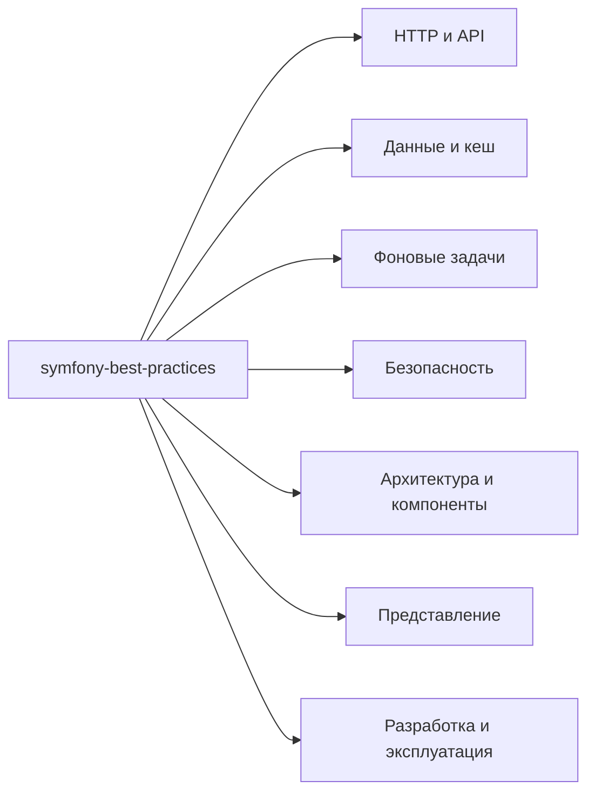

# Symfony Best Practices Skill

Agent Skill для разработки, диагностики и ревью **Symfony 8.x** приложений.

**0.1.0** · **7 блоков** · **31 справочник**.

[SKILL.md](skills/symfony-best-practices/SKILL.md) и справочники написаны на английском. README — на русском.

## Покрытие



| Блок | Темы |
| --- | --- |
| **HTTP и API** | [Routing, Controllers, HttpKernel](skills/symfony-best-practices/references/http/routing-and-kernel.md); [REST, RFC 9457](skills/symfony-best-practices/references/http/rest-api.md); [DTO, Forms, Validator](skills/symfony-best-practices/references/http/validation-and-forms.md); [Session](skills/symfony-best-practices/references/http/sessions.md); [Serializer](skills/symfony-best-practices/references/http/serializer.md); [HttpClient, Webhook](skills/symfony-best-practices/references/http/http-client-and-webhooks.md) |
| **Данные и кеш** | [Doctrine ORM, transactions, locking](skills/symfony-best-practices/references/data/doctrine-modeling.md); [запросы, pagination, batches](skills/symfony-best-practices/references/data/doctrine-performance.md); [Migrations](skills/symfony-best-practices/references/data/migrations.md); [Cache, TTL, invalidation](skills/symfony-best-practices/references/data/cache.md) |
| **Фоновые задачи** | [Messenger, retries, idempotency, outbox](skills/symfony-best-practices/references/async/messenger.md); [Scheduler](skills/symfony-best-practices/references/async/scheduler.md); [Mailer, Notifier](skills/symfony-best-practices/references/async/mailer-and-notifier.md) |
| **Безопасность** | [Users, firewalls, passwords, CSRF](skills/symfony-best-practices/references/security/authentication.md); [JWT, refresh, revocation](skills/symfony-best-practices/references/security/jwt.md); [authorization, voters, RateLimiter](skills/symfony-best-practices/references/security/authorization-and-rate-limiting.md) |
| **Архитектура и компоненты** | [Services, domain, CQRS, ports/adapters](skills/symfony-best-practices/references/architecture/architecture.md); [модули, bundles](skills/symfony-best-practices/references/architecture/bundle-organization.md); [Console](skills/symfony-best-practices/references/architecture/console-commands.md); [DI, Kernel, Events](skills/symfony-best-practices/references/architecture/container-and-events.md); [Workflow, Lock](skills/symfony-best-practices/references/architecture/workflow-and-locks.md); [Filesystem, UID, YAML, ExpressionLanguage](skills/symfony-best-practices/references/architecture/framework-utilities.md); [AI Bundle, MCP Bundle](skills/symfony-best-practices/references/architecture/ai-integration.md) |
| **Представление** | [Twig, Translation, escaping](skills/symfony-best-practices/references/presentation/twig-and-translation.md); [UX Twig Components](skills/symfony-best-practices/references/presentation/twig-components.md) |
| **Разработка и эксплуатация** | [Runtime, quality checks](skills/symfony-best-practices/references/workflow/workflow-and-quality.md); [configuration, env, secrets](skills/symfony-best-practices/references/workflow/configuration.md); [PHPUnit, Foundry, Panther/Playwright](skills/symfony-best-practices/references/workflow/testing.md); [logging, error pages](skills/symfony-best-practices/references/workflow/logging-and-errors.md); [deployment, performance, HTTP cache](skills/symfony-best-practices/references/workflow/deployment-and-performance.md); [AI Mate](skills/symfony-best-practices/references/workflow/ai-mate.md) |

## Совместимость

- **Symfony 8.x, PHP 8.4+.** Документация сверена на 2026-10-15 по линии 8.1. Отличия 8.0 отмечены отдельно.
- **API выбираются по установленным версиям.** Doctrine, Foundry, UX, Lexik и Symfony AI имеют отдельные версии.
- **Архитектура следует проекту.** CQRS, DDD, ports и отдельные buses применяются по задаче.
- **Команды используют окружение проекта.** Операции с БД, кешем и очередями требуют соответствующего контекста и разрешений.
- **Результат подтверждают проверки проекта.** Локальные тесты, CI, deployment и работа с реальным provider проверяются отдельно.

## Установка

Скопируйте весь каталог `skills/symfony-best-practices/` в каталог skills вашего агента. Сохраните справочники, metadata и лицензии.

Типовая структура проекта:

```text
<project>/.agents/skills/symfony-best-practices/
    SKILL.md
    agents/openai.yaml
    references/
    LICENSE
    THIRD_PARTY_NOTICES.md
    SOURCES.md
    sources.json
```

Для глобальной установки Codex используйте `${CODEX_HOME:-$HOME/.codex}/skills/`. Расположение зависит от агента. При обновлении сохраните локальные изменения.

Вызов: `$symfony-best-practices`. Метаданные Codex также допускают автоматический выбор скилла. Python нужен только для проверки и сборки пакета.

## Источники

**42 донорских скилла** и **40 страниц документации Symfony**. Все 43 заданных URL учтены, включая Security anchors. Версии и SHA-256 закреплены в пакете.

[Доноры и карта справочников](skills/symfony-best-practices/SOURCES.md) · [Manifest](skills/symfony-best-practices/sources.json) · [Исправления](docs/source-review.md) · [Обзор документации](docs/official-documentation-review-2026-10-15.md)

## Проверка и сборка

Из корня репозитория, Python 3.11+:

```sh
python3 -m venv .venv
.venv/bin/python -m pip install -r requirements-dev.txt
.venv/bin/python scripts/validate.py
.venv/bin/python -m unittest discover -s tests -v
.venv/bin/python scripts/build_release.py
```

На Windows используйте `.venv\Scripts\python.exe`.

Сборка создаёт `dist/symfony-best-practices-0.1.0.tar.gz`, `.zip` и `SHA256SUMS`. Архивы содержат каталог `symfony-best-practices/`.

[Результаты проверок и команды сверки исходников](docs/verification-0.1.0.md) · [Дизайн](docs/superpowers/specs/2026-10-13-symfony-skill-0.1.0-design.md) · [План](docs/superpowers/plans/2026-10-13-symfony-skill-0.1.0.md) · [Changelog](CHANGELOG.md)

## Лицензия

Собственный пакет — [MIT](LICENSE). Symfony Docs — справочный источник под CC BY-SA 3.0. Текст руководства и его примеры в пакет не включены.

Полные MIT notices двух доноров и Symfony AI: [THIRD_PARTY_NOTICES.md](skills/symfony-best-practices/THIRD_PARTY_NOTICES.md).
